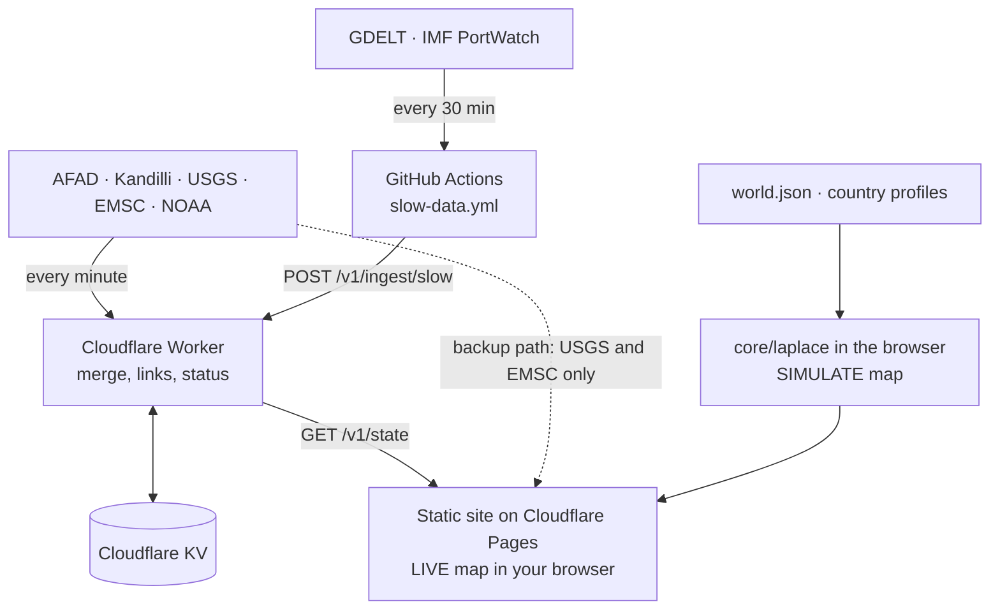

# VigilRadar


This started two months ago as a private side project called **Monitoring** that has been quietly running online ever since. The problem was that I got way too carried away: twenty map layers, satellites, military bases, eighteen live counters, twenty-three apocalypse essays... opening my own dashboard exhausted even me.

While dusting off old projects from my private archive to clean up my portfolio (and hopefully land a job), I decided to rescue it and open-source it — with a brutal haircut. I archived the earthquake early-warning experiment in a git tag after physics and government API latency politely defeated it, stripped out the blinking-pin chaos every "God's Eye" map already does, and rebuilt **VigilRadar** around the one thing I actually wanted to exist:

A calm, **$0/month** live global risk desk paired with a pocket-sized **Laplace's Demon** — a deterministic domino-effect simulator where you can clog a strait, cut a subsea cable corridor, or trigger a volcanic winter, drag time forward from Day 1 to Day 180, and see *which* countries get hit, *through which channels*, and *why*.

> **Yes, an EE student shipped a Next.js app:** I usually live in Python and signal/data pipelines, so turning this into a fast web app took some teamwork. The vision, architecture, data rules, and ruthless simplification are mine — **Antigravity** and **Claude Code** handled the TypeScript grind, map optimization, and Cloudflare wiring while I kept yelling at them to make the UI simpler.

| Project | What it hunts |
|---|---|
| [TESS Planet Hunter](https://github.com/CemreMetin/tess-planet-hunter) | Part I of the Sunday Hunter trilogy: exoplanet candidates in NASA TESS light curves |
| [Subsurface Ghost Hunter](https://github.com/CemreMetin/subsurface-ghost-hunter) | Part II: buried archaeology around Niğde in stacked Sentinel-2 imagery |
| [ZTF Shadow & Blindspot Hunter](https://github.com/CemreMetin/ztf-shadow-hunter) | Part III: stars that suddenly go dark, and events two classifiers disagree on |
| [VigilRadar](https://github.com/CemreMetin/VigilRadar) | Same house rules: a free cloud that runs itself, and a two-minute check over Sunday coffee |

### My Twist on Global Risk Monitoring

- **Dominoes, not blinking pins.** A dot says something happened. VigilRadar plays what comes next: a five-channel impact wave across 176 countries, with a time player from Day 1 to Day 180.
- **Transparent math, zero AI fortune-telling.** No LLM anywhere. The model is plain TypeScript you can read in one sitting, its steps cite EIA, IMF PortWatch, FAO, World Bank and TeleGeography among others, and each one wears an `A / B / C` evidence label.
- **Zero-cost autopilot (`$0/month`).** Cloudflare Pages serves the site, a Worker runs every minute, GitHub Actions runs every 30 minutes. If the Worker is down, your browser asks USGS and EMSC directly.
- **Brutally honest about what it is NOT.** Not an early warning, not a damage report, not a prophecy. The coefficients are calibrated judgement, and the interface says so.

## What It Tracks & Simulates

### LIVE: four data streams

| Stream | Sources | How often |
|---|---|---|
| Earthquakes (M5+ worldwide, M4+ around Türkiye) | AFAD, B.Ü. KRDAE (Kandilli), USGS, EMSC | every minute |
| Tsunami bulletins | NOAA NTWC and PTWC | every 5 minutes |
| Conflict clusters (media reports, unverified) | GDELT | every 30 minutes |
| Ship traffic through six straits | IMF PortWatch (a few days behind at the source) | every 30 minutes |

Each event is checked for one thing: is it close to a nuclear plant or a sea strait?

### SIMULATE: eight shocks

| Shock | The question |
|---|---|
| Hormuz | A fifth of seaborne oil and LNG stays in the Gulf |
| Suez | Asia–Europe shipping goes around the Cape |
| Taiwan | Advanced chips and the East Asian corridor stop |
| Red Sea cables | The Europe–Asia fibre corridor breaks |
| Black Sea | Grain, sunflower oil, fertiliser and crude cannot get out |
| Panama | Drought limits the canal |
| VEI 7 eruption | A Tambora-scale volcanic winter |
| G5 solar storm | A Carrington-scale storm hits grids and satellites |

Every shock reaches a country through **five channels**:

- **Energy**: fuel and power supply.
- **Trade**: shipping, ports, parts.
- **Food**: grain, fertiliser, harvests.
- **Digital**: cables, chips, satellites.
- **Prices**: inflation and the wider economy.

Pick a country and you get the five scores, a three-step domino chain with timing, evidence and source, and the peak window. `/?mode=sim&shock=hormuz&sev=80&day=30&country=TUR` is a link you can send to someone.

## How It Works



### The model, in full

For each country, shock and channel:

```text
score = 100 × clamp(exposure × weight × severity × wave(day), 0, 1)

wave(day)  before onset:  0.08 × day / onset                         (early market signal)
           onset → peak:  smooth S-curve from 0.08 to 1
           after peak:    persistence + (1 − persistence) × e^(−(day − peak) / 90)

total      = 0.55 × strongest channel + 0.45 × mean of the three strongest
```

`exposure` is the country's structural dependency (0 to 1), never below the shock's global spillover floor. 44 key economies have hand-set profiles (evidence B). The other 132 countries get a fallback built from the spillover floor, hunger and water stress, distance to the shock and, for the solar storm, latitude (evidence C). A documented fact opens some chains (evidence A).

The numbers are judgement calls informed by public statistics, not measurements and not a forecast. If you think one is wrong, you are probably able to prove it, which is the point of keeping them in plain files.

## Run Locally / Deploy Your Own ($0/month)

```bash
npm ci && npm run dev
```

Open <http://localhost:3000>. It works without any account: with no Worker configured, the page uses the USGS and EMSC backup path. To put your own copy online (Cloudflare Pages, a Worker, GitHub Actions), follow [docs/SETUP.md](docs/SETUP.md).

```bash
npx next typegen && npx tsc --noEmit
npm run lint
npm test
npm run build
```

| Part | Where |
|---|---|
| Site (Next.js static export) | `app/`, `components/`, `lib/` |
| Shared pure logic | `core/` |
| Simulator | `core/laplace/` |
| Worker | `daemon/` |
| Slow lane | `scripts/data/slow.mjs` |
| Old data pipeline behind the older content pages (committed snapshots) | `worker/` |

Architecture notes and decisions are logged in [docs/DECISIONS.md](docs/DECISIONS.md) (in Turkish).

## Contributing

Pull requests with a source attached are the best kind.

**Fix or add a country profile**

1. Open `core/laplace/countries.ts`. A profile is one line: ISO code, the exact name used in `public/data/static/world.json`, region, centre, and one `"energy trade food digital prices"` string (in percent) per shock.
2. A new profile also leaves the fallback list (`OTHERS`) in the same file.
3. A documented fact goes into `NOTES` with its source.
4. Run `npm test`. The map-name and sanity tests will tell you if something drifted.

**Add a shock**

1. Add its id to `ShockId` in `types.ts` and its definition (position, channel weights and timing, spillover floor, sources) to `shocks.ts`.
2. Add its texts in English and Turkish to `copy.ts` (`SHOCK_COPY` and `STEP_COPY`).
3. Give the 44 profiles their exposure (the `ORDER` list in `countries.ts`).
4. Add one test that states what should be true in the real world.

## Sources & License

Live data: USGS, EMSC (CC BY 4.0), AFAD, B.Ü. KRDAE Bölgesel Deprem-Tsunami İzleme ve Değerlendirme Merkezi (attribution required), NOAA/NWS, GDELT, and IMF PortWatch (Sources: UN Global Platform; IMF PortWatch, portwatch.imf.org).

Static data: Natural Earth, GeoNames (CC BY 4.0), GeoNuclearData (ODbL 1.0), TeleGeography Submarine Cable Map (CC BY-NC-SA 3.0).

Cited by the simulator: EIA, IEA, UNCTAD, UN Comtrade, FAO, World Bank, TeleGeography, ICPC, SIA, Panama Canal Authority, Robock (2000), Raible et al. (2016), NOAA SWPC, USGS Geomagnetism, Lloyd's / AER. The full list with links is on the `/about` page; the older content pages list theirs on `/sources`.

Code: [MIT License](LICENSE) — read it, run it, change it, share it. Third-party data keeps its own licence.

---

## Türkçe özet

**VigilRadar resmi bir uyarı sistemi değildir ve erken uyarı vermez.** Acil durumda 112'yi ara, AFAD'ın açıklamalarını izle.

Tek harita, iki mod: **CANLI** modunda büyük depremler, tsunami bültenleri, çatışma kümeleri ve altı boğazın gemi trafiği; **SİMÜLE** modunda "Hürmüz kapanırsa ülkemi hangi kanallardan, hangi sırayla, kaç haftada etkiler?" sorusunu deterministik bir bağımlılık modeliyle oynatan Laplace Kaskat Simülatörü. Yapay zekâ tahmini yok; her adımın kanıt etiketi ve kaynağı yazar.

Yerelde çalıştırmak için `npm ci && npm run dev`; kendi kopyanı yayınlamak için [docs/SETUP.md](docs/SETUP.md).
